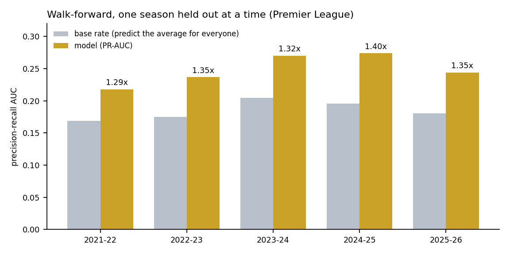

# Yellow card prediction

Which starters will be booked in a football match? Given the confirmed line-ups, about an
hour before kick-off, this scores every outfield starter in the big five European leagues
(Premier League, Serie A, La Liga, Bundesliga, Ligue 1) with a probability that they, or
the player who replaces them, pick up a card.

It is a small-signal problem, and most of the work here is about not fooling yourself: no
feature may use information from after kick-off, every comparison is made on matches the
model has never seen, and the experiments that failed are kept and written up.



## What it does

- **Predicts a "slot", not just a player.** A starter's slot is hit if he *or his
  replacement* is booked, so the label is built from the substitution chain. FBref publishes
  no "X replaced Y" field; the chains are recovered from the order of its player tables and
  validated on all 6,080 team tables in the archive (exactly 11 slots every time).
- **One model for five leagues.** A five-league ensemble: ten bagged gradient-boosted trees,
  a regularised logistic regression, and a team-level count model multiplied by each
  player's share. The weights were chosen walk-forward, not on a held-out peek.
- **Features from history only.** Player and referee card rates (shrunk towards a league
  prior with empirical Bayes), league position, Elo, fixture difficulty, what is at stake,
  and the market's closing 1X2 price. 32 features in all.

## Results

On the Premier League, refitting each season and testing on the next, the model is a modest
but consistent improvement on knowing only the average card rate:

| | |
|---|---|
| PR-AUC lift over the base rate | **1.34 ± 0.04** (every one of five seasons between 1.29 and 1.40) |
| ROC-AUC | about 0.60 |
| A match's top three picks include at least one booking | **61%** of matches |
| Calibration (ECE) | 0.019 |

Across all five leagues (8,905 matches, 2021-26), the ensemble finds 1.058 bookings in its top
four picks per match; the best single component finds 1.059 and a plain logistic regression
1.052. **The honest reading is that the gain over a simple model is small**: the value is in
the feature construction and the evaluation discipline, not in a clever learner. The
engineering log shows the intervals, and what did not help.

## Things worth a look

- **The leakage gate** (`tests/test_pipeline.py`): rebuild the entire feature table from a
  truncated history and assert that every surviving row is bit-identical to the full build.
  If any feature peeked at a later match, this fails. It was written because an earlier
  version of the pipeline *did* leak, through misaligned rolling features.
- **Train/serve parity** (`tests/test_serving.py`): replay a played match as if it were
  upcoming and require the served probability to equal the training row exactly. It guards
  against two silent bugs found this way, which had left league position and stakes
  missing for every served fixture.
- **Paired evaluation.** Candidate features are judged on the same matches, paired by season
  and bootstrapped by match (`research/odds_verdict.py`), because season-to-season spread
  swamps small gains and rows inside a match are not independent.
- **Negative results kept**: referee features, richer player context, replacement-leg
  features, a two-stage model, per-segment specialists, post-hoc calibration. Each is built,
  measured and documented, and re-enabling any of them is a one-line config change.
- **A known limitation, stated and measured** rather than hidden: the empirical-Bayes priors
  are fitted once on the training seasons, so absolute walk-forward figures carry a small
  optimistic bias (the A/B comparisons are unaffected). See the engineering log.

## Run it

```bash
pip install -r requirements.txt        # Python 3.11
python tools/demo.py                   # about ten minutes, no real data needed
```

The demo generates a **synthetic** league (invented clubs, players and referees, in exactly
the layout of the real scrape), parses it with the real parser, builds the feature table,
and runs the integrity and leakage gates for both the card model and the match-result
model. It writes to `data_synthetic/` and `artifacts_synthetic/` only. The numbers it
prints say nothing about real football; the point is that the pipeline and its gates run.

Two gates (`tests/test_serving.py`, `tests/test_history_features.py`) need the trained
five-league ensemble and the real data, and report `SKIPPED` without them.

### Getting the data

Neither the data nor the trained models are in this repository; both come from third parties.

| source | script | what it provides |
|---|---|---|
| football-data.co.uk | `pipeline/download_odds.py` | results and closing prices, all five leagues |
| FBref | `pipeline/scrape_fbref.py` | player-level match reports (needs Chrome and selenium) |
| Understat (optional) | `pipeline/fetch_understat.py` | team xG; tested, not used |

Check each site's terms before scraping. The FBref scraper is deliberately slow (about 12
seconds a match, one worker, resumable); five leagues across nine seasons takes on the order
of a day. Data goes under `data/fbref/<league>/<season>/...` and `data/odds/<league>/`.

Then, for the real model:

```bash
python pipeline/build_base_table.py                        # match folders -> base tables
python pipeline/features.py                                # base tables -> model dataset
python tests/test_pipeline.py                              # integrity + leakage gates
python pipeline/pooled.py build --first-season 2017-2018   # the other four leagues
python pipeline/ensemble.py all                            # walk-forward, weights, artifact
python tests/test_serving.py                               # train/serve parity
python serve/predict.py                                    # score a fixture
```

`YCP_DATA_DIR` and `YCP_ARTIFACT_DIR` relocate the data and the generated files.

## Layout

```
pipeline/    data -> features -> models (config.py holds every tunable)
serve/       scoring fixtures with the served ensemble
research/    the experiments behind the design; nothing in serve/ depends on them
tests/       leakage gates, train/serve parity
match_model/ a separate match-result pipeline (1X2, goals, both teams to score)
notebooks/   annotated walk-throughs, generated by the build_*.py scripts beside them
tools/       the synthetic-data generator and demo runner
docs/        engineering-log.md - the long-form record of what was tried and why
```

Start with `notebooks/card_prediction_pipeline.ipynb`, or read
[`docs/engineering-log.md`](docs/engineering-log.md) for the full story. The match-result
model has its own [README](match_model/README.md); its main finding is also a negative one:
it is well calibrated and roughly as accurate as the market, but it does not beat the
closing line.

## Notes

- "v2" and "v3" in the log and some comments are earlier private iterations of this project;
  this repository is the v3 code.
- Notebook outputs were produced on the real data. One chart, whose title used outdated
  wording, was removed from `card_prediction_pipeline.ipynb` rather than redrawn.

MIT licence.
